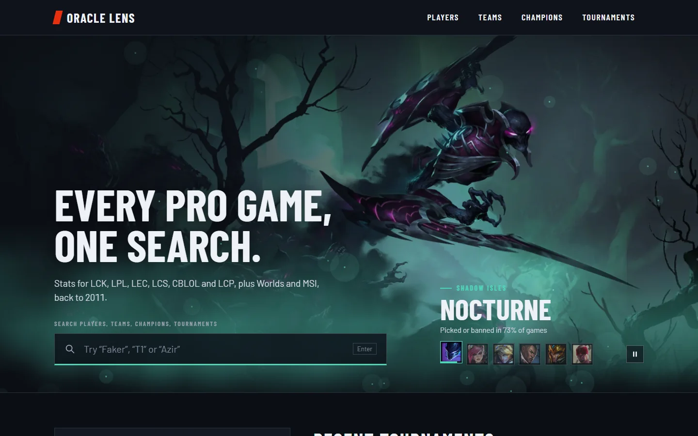
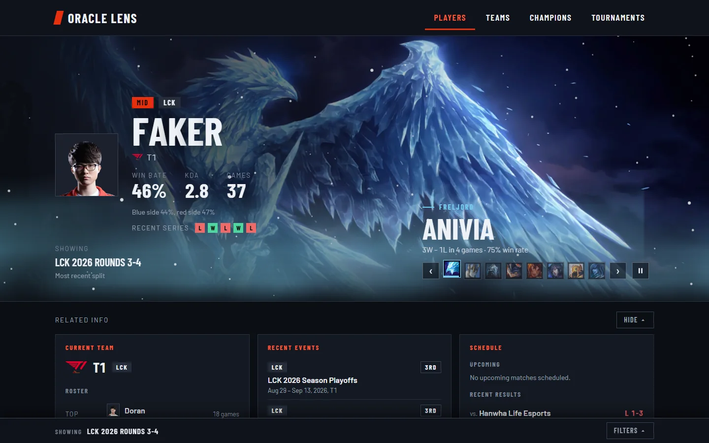
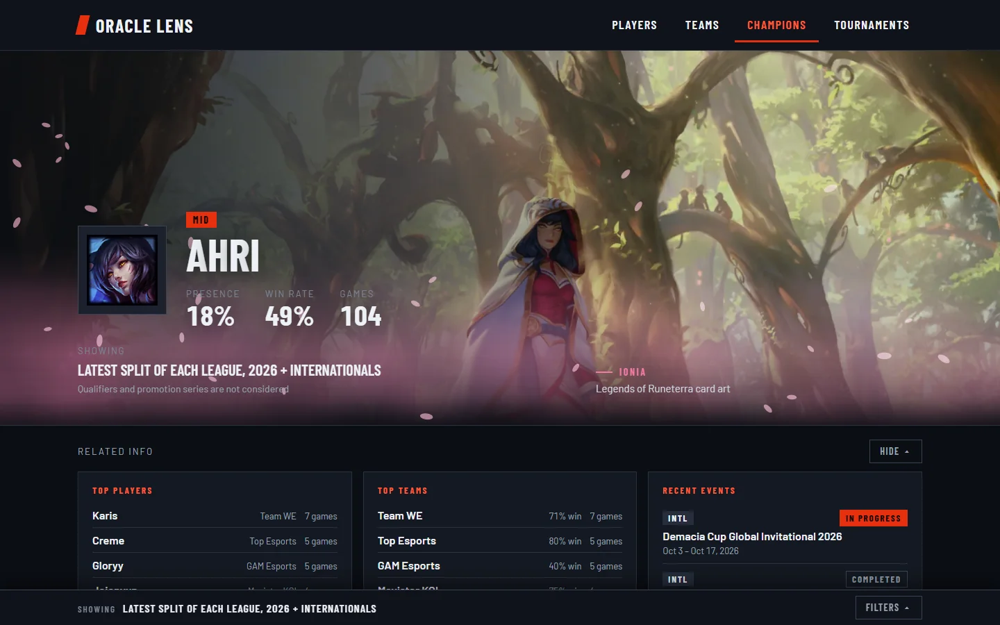
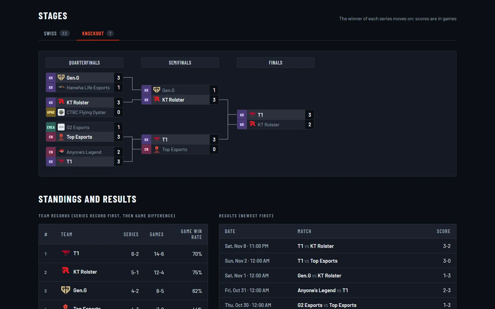
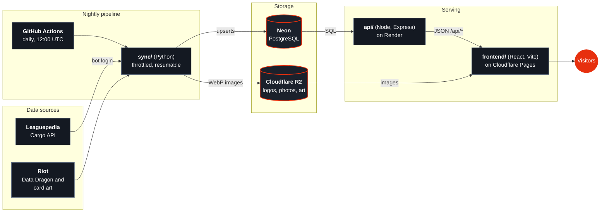

# Oracle Lens

Browse professional League of Legends esports stats: players, teams, champions, and tournaments, with sortable leaderboards, matchup breakdowns, and shareable filters. All data comes from [Leaguepedia](https://lol.fandom.com)'s Cargo API, synced into our own Postgres database. The site never calls Leaguepedia when a visitor loads a page.

> **Status: live at [oracle-lens.pages.dev](https://oracle-lens.pages.dev).** Every page in the plan is built: the home page (search and recent tournaments), the four lists (players, teams, champions, tournaments) and their detail pages, with tournament stages and brackets, on the full backfill (all six leagues, 2011 onward, plus internationals). A nightly sync keeps it current. See the [Roadmap](#roadmap).

<p align="center">
  <a href="https://oracle-lens.pages.dev"></a>
</p>

<table>
  <tr>
    <td width="33%"><a href="https://oracle-lens.pages.dev/players/Faker"></a><br><sub><b>Player pages</b>: stats, champion pool, matchups and linked context</sub></td>
    <td width="33%"><a href="https://oracle-lens.pages.dev/champions/Ahri"></a><br><sub><b>Champion pages</b>: presence, win rate, top players and teams</sub></td>
    <td width="33%"><a href="https://oracle-lens.pages.dev/tournaments/worlds-2025"></a><br><sub><b>Tournaments</b>: Swiss, group and knockout stages drawn as brackets</sub></td>
  </tr>
</table>

## Built with

| | |
|---|---|
| **Frontend** | [React](https://react.dev), [Vite](https://vite.dev), [TypeScript](https://www.typescriptlang.org), [React Router](https://reactrouter.com), [Motion](https://motion.dev) |
| **API** | [Node.js](https://nodejs.org), [Express](https://expressjs.com), [node-postgres](https://node-postgres.com), [Zod](https://zod.dev), [express-rate-limit](https://github.com/express-rate-limit/express-rate-limit), [Vitest](https://vitest.dev) and [Supertest](https://github.com/forwardemail/supertest) |
| **Sync** | [Python](https://www.python.org), [mwrogue](https://github.com/RheingoldRiver/mwrogue) and [mwclient](https://github.com/mwclient/mwclient), [Psycopg](https://www.psycopg.org), [Pillow](https://python-pillow.org), [boto3](https://github.com/boto/boto3), [pytest](https://pytest.org) |
| **Database** | [PostgreSQL](https://www.postgresql.org), hosted on [Neon](https://neon.com); [Docker](https://www.docker.com) for the local copy |
| **Hosting** | [Cloudflare Pages](https://pages.cloudflare.com) (frontend), [Render](https://render.com) (API), [Cloudflare R2](https://www.cloudflare.com/developer-platform/products/r2/) (images and card art) |
| **Automation** | [GitHub](https://github.com) and [GitHub Actions](https://github.com/features/actions) for CI, the nightly sync and the secret scan; [UptimeRobot](https://uptimerobot.com) to keep the API awake |
| **Analytics** | [Cloudflare Web Analytics](https://www.cloudflare.com/web-analytics/): no cookies, no consent banner |
| **Data and assets** | [Leaguepedia](https://lol.fandom.com) (Cargo API), Riot's [Data Dragon](https://developer.riotgames.com/docs/lol#data-dragon) and [Legends of Runeterra](https://developer.riotgames.com/docs/lor) card art, [Google Fonts](https://fonts.google.com/specimen/Barlow) (Barlow) |

## Architecture



A visitor's browser only ever talks to the frontend, the API and the image bucket. Leaguepedia and Riot are called by the nightly sync, never when a page loads.

| Folder | What it is |
|---|---|
| `frontend/` | React + Vite + TypeScript UI |
| `api/` | Express + TypeScript API, SQL migrations, vitest suite |
| `sync/` | Python loader (`backfill` mode implemented; `nightly` loads only new data) |
| `docker-compose.yml` | Local Postgres 16 for development |

Design decisions worth knowing:

- **Derived stats are computed in SQL from raw columns**, never stored (KDA, kill participation, damage/gold share, per-minute rates).
- **Missing stats are `NULL`, never 0.** They are excluded from averages and shown as "N/A" in the UI.
- **`role` lives on `player_game`**, not on the player, because players occasionally swap roles.
- **Filters live in the URL query string**, so every filtered view is a shareable link.
- **Minimum sample of 5 games** for winrate rankings. Champions under 5 games stay in a player's pool but are grayed out.

## Prerequisites

- Node.js 22+ and npm
- Python 3.11+
- Docker (for local Postgres)
- Optional: a Leaguepedia bot password for higher rate limits (see [Sync](#sync))

## Local development

```bash
cp .env.example .env            # then edit if needed
docker compose up -d            # Postgres on localhost:5432
```

Install and migrate the API, then start it:

```bash
cd api
npm install
npm run migrate                 # applies api/migrations/*.sql in order
npm run dev                     # http://localhost:3001
```

Start the frontend (it proxies `/api` to port 3001):

```bash
cd frontend
npm install
npm run dev                     # http://localhost:5173
```

Load some data (see [Sync](#sync)), then open `http://localhost:5173/players/<player name>`.

### Environment variables

Configured in the repo-root `.env` (never committed). See `.env.example`.

| Variable | Purpose |
|---|---|
| `DATABASE_URL` | Postgres connection string. Defaults to the local Docker database; point it at Neon for production (TLS is enabled automatically for `neon.tech` hosts). |
| `PORT` | API port (default `3001`). |
| `LEAGUEPEDIA_BOT_USER`, `LEAGUEPEDIA_BOT_PASSWORD` | Optional Leaguepedia bot password (`Username@botname` plus the generated password). Anonymous access is rate-limited almost immediately. |

## Sync

The sync is a Python CLI in `sync/`.

```bash
cd sync
python -m venv .venv
.venv\Scripts\activate          # macOS/Linux: source .venv/bin/activate
pip install -r requirements.txt

python main.py backfill --all --list                               # show every in-scope tournament, load nothing
python main.py backfill --all                                      # everything not yet done (resumable)
python main.py backfill --all --year-from 2025 --year-to 2025      # just a slice
python main.py backfill --latest                                   # most recent finished LCK regular-season split
python main.py backfill --tournament "LCK/2026 Season/Rounds 3-4"  # a specific Leaguepedia page
python main.py backfill --all --force                              # re-sync even if already done
python main.py logo-tones                                          # measure which team logos are too dark for the dark panels (they are then shown on a light plate)
python main.py schedule                                           # refresh every series' date and round (the bracket and stage tabs are built from these); --tournament PAGE limits it to one event
python main.py art                                                 # cache the Legends of Runeterra card art as small WebP files under frontend/public/img/art (about 12 MB; run once)
python main.py upload-images --from ../frontend/public/img        # put the cached art (and any new logos and photos) on R2; the site falls back to Riot's CDN for anything missing
python main.py results                                             # fetch final placements (1st, 3rd-4th, ...) for every event
python main.py schedule                                            # refresh match dates (series.scheduled_at) without reloading games
python main.py nightly                                             # only what is new: unfinished tournaments, match dates, champion icons (about 30 seconds)
python main.py images                                              # cache team logos and player photos, and record champion icon keys
python main.py images --only teams --limit 20                      # a quick trial
```

**Nightly update.** `python main.py nightly` skips every tournament already marked `done`, loads new and still-running ones (a reload is idempotent), refreshes match dates for the last 14 days, and refreshes champion icon keys. It also refreshes final placements (from Leaguepedia's `TournamentResults`) for events that ended in the last 45 days or have none yet; the recent-events panels on player and team pages show them in place of "Completed". It exits non-zero if a tournament failed, so a scheduler can flag it; run it again to retry. It deliberately leaves team logos and player photos out, because they are files and a scheduled runner has no permanent disk (they need somewhere to live in production; see the roadmap). `.github/workflows/nightly-sync.yml` runs it on GitHub Actions; it runs every day at 12:00 UTC (and on demand from the Actions tab) using the seven repository secrets it lists; `python sync/set_github_secrets.py` sets them from `.env`.

A full run takes a few hours (roughly 10-20 seconds per tournament with the bot login). It writes a log to `sync/logs/` (gitignored), continues past individual failures, and picks up where it left off if you run it again.

**What is in scope:** every official tournament of LCK, LPL, LEC, LCS, CBLOL and LCP (including their earlier names), the regional finals gauntlets, and all official internationals (Worlds including Play-In, MSI, First Stand, Rift Rivals, and so on). Showmatches and events with no recorded games are skipped.

How it works:

- Reads `ScoreboardGames`, `ScoreboardTeams`, `ScoreboardPlayers`, `PicksAndBansS7`, `MatchSchedule`, and `Tournaments`.
- Resolves historical names to current ones: league names via `sync/league_aliases.yaml` (hand-written), player names via `PlayerRedirects`, team names by following `Teams.RenamedTo`. Lookups are cached for the whole run.
- Leagues roll up under their current name: EU LCS → LEC, NA LCS → LCS, OGN Champions ("LoL The Champions", 2012-2015) → LCK, 2025 LTA North → LCS, 2025 LTA South → CBLOL, and pre-2025 PCS/VCS/LJL → LCP (with the old name kept as `sub_region`). From 2025 PCS, VCS and LJL continue as second-tier leagues, so those tournaments are not loaded.
- **2025 LTA playoffs** include teams from both conferences. They have no single league; each team's games land in its own conference's league through the `tournament_team_league` table, so those games count toward both LCS and CBLOL history.
- Leaguepedia tags each region's Worlds "Regional Finals" with `League = World Championship`; these are loaded as domestic events of that region's league, not as internationals.
- For games without a `PicksAndBansS7` row (older eras) the draft comes from `ScoreboardTeams`: bans keep their slot order, and picks are stored with `draft_order = NULL` because their real order is unknown.
- Progress is tracked per tournament in the `sync_state` table. Re-running is idempotent. A tournament that has not finished yet stays `pending` so a later run completes it.
- Uses throttling and exponential backoff on rate limits. If the database connection drops mid-run (for example the machine slept), the run reconnects and retries instead of hanging.
- Names are matched case-insensitively and normalised the way the wiki does, placeholder values (`None`, `TBD`, `Missing Data`) are never stored, and split-less playoffs and Regional Finals are given the split they belong to (`assign_missing_splits()`, run after every sync).

After a run, check the data with the read-only health report:

```bash
python verify.py          # integrity checks, games per league and year, and missing stats by era
```

`python repair_names.py` (dry run by default, `--apply` to change data) merges duplicate players or teams that earlier loads stored under different spellings.

Run the sync unit tests with `python -m pytest` inside `sync/`.

Leaguepedia field findings, including known gaps, are documented in [`sync/FIELDS.md`](sync/FIELDS.md).

## API

All player stat endpoints accept the filters `league`, `year`, `split`, `tournament`, `patch`, `side` (`blue`/`red`), `role`, and `domestic` (`true`/`false`).

| Endpoint | Returns |
|---|---|
| `GET /api/players/:id` | Profile, resolved range, summary stats. `:id` is the player's page name or numeric id. |
| `GET /api/players/:id/champions` | Champion pool; entries under 5 games are included and flagged `underMinSample`. |
| `GET /api/players/:id/matchups/players` | Record and average gold difference against each opposing laner in the same role. |
| `GET /api/players/:id/matchups/champions` | Record and average gold difference against the champion the lane opponent played. |
| `GET /api/players/:id/target-bans` | Champions the player has played that opponents banned, with the share of games. |
| `GET /api/players/:id/context` | The related-info strip on the player page: current (or last) team and its roster, running events, upcoming series and recent results. Ignores the stat filters. |
| `GET /api/teams/:id` | Team profile (`:id` is the exact team name or numeric id), resolved range and summary: record, side split, game length, kills and deaths per game, gold per minute and difference, objectives per game. Same filters as players except `role`. |
| `GET /api/teams/:id/players` | Everyone who played for the team in the range, with their stats for this team only (entries under 5 games are flagged). |
| `GET /api/teams/:id/draft` | Most picked champions with records, the team's own most frequent bans and the bans made against it (`limit`, default 8). |
| `GET /api/teams/:id/opponents` | Head-to-head game record and average gold difference per opposing team (`limit`, default 8). |
| `GET /api/teams/:id/context` | The related-info strip on the team page: latest roster, running events, upcoming series and results. Ignores the stat filters. |
| `GET /api/champions/:name` | Champion profile and summary for the range: games, win rate, blue/red split, pick rate, ban rate and presence (shares of all games in the range), KDA, kill participation, damage/gold/CS per minute, game length, main role. Same filters as the leaderboard, including `role` and `qualifiers=true`. |
| `GET /api/champions/:name/players`, `/teams`, `/matchups`, `/roles`, `/patches` | Top players and teams on the champion, record against each lane opponent's champion (with gold difference), results by role (ignores the role filter) and by patch with per-patch pick rate. `limit` applies to the first three (default 8). |
| `GET /api/champions/:name/context` | The related-info strip on the champion page: top players, top teams and recent events. Ignores the stat filters. |
| `GET /api/tournaments/:id` | One event (`:id` is the numeric id the search and home links use): league (or the leagues of a multi-league event), stage, status, dates, and a summary: games, series, teams, game length, blue-side win rate, kills per game, patches, and the leader (while running) or champion (finished playoffs and internationals). |
| `GET /api/tournaments/:id/standings`, `/matches`, `/players`, `/champions` | Team records (series first, then game difference), results newest first plus upcoming scheduled series (`limit`, default 20 for results), top players by KDA (minimum 5 games, or everyone for very short events), and champion picks, bans and presence. |
| `GET /api/tournaments/:id/context` | The related-info strip on the tournament page: leading teams, upcoming and latest series, and the other events of the same league and year (or the other internationals). |
| `GET /api/teams`, `/api/champions`, `/api/tournaments` | The list pages. All take `q` (name search), `dir`, `page` and `pageSize`, and a `sort` from a fixed set. **Teams** (`sort`: `winRate` default, `games`, `goldDiff`, `killsPerGame`, `towersPerGame`, `avgGameLengthSec`; minimum 5 games) and **champions** (`sort`: `presence` default, `games`, `winRate`, `pickRate`, `banRate`, `kda`) use the leaderboard's default range and filters, and champions rank rows under 5 games after the rest when sorting by win rate or KDA. **Tournaments** (`sort`: `date` or `name`) filter by `league` (or `INTL`), `year`, `stage` and `status`, and hide qualifiers unless `stage=Qualifier`. |
| `GET /api/assets/images` | Which champions, teams and players have an image: the Data Dragon version, champion name to icon key, team name to logo file and player page to photo file. Loaded once by the front end and cached for five minutes. |
| `GET /api/search?q=` | Players (including old names), teams, champions and tournaments matching `q` (2+ characters), grouped by type, prefix matches first. `limit` per group (default 4). |
| `GET /api/tournaments/recent` | The newest official events with games, qualifiers excluded. Each has a status (`In progress` while today is inside its dates) and a standing: the current leader while running, the champion for finished playoffs and internationals, otherwise the team with the best record. `limit` default 5. |
| `GET /api/leaderboard/players` | Ranked players for the leaderboard page (see below). |
| `GET /api/filters` | Available leagues, years, splits, patches. Years with only qualifier games are left out. |
| `GET /api/meta/last-updated` | Timestamp of the last successful sync (shown in the footer). |

**Default range:** with none of `league`/`year`/`split`/`tournament`/`patch` set, a player's page shows their most recent domestic split plus any international events from that split's start onward. `domestic=true` restricts it to the league's split only. Any explicit filter replaces the default range. `range=all` (with none of those filters) shows every game in the tracked leagues and internationals, labelled "All time"; `domestic=true` and `side` still apply, and any explicit filter overrides it. The player, team and champion pages and the teams list support it; the player leaderboard and the champions list do not yet, because over all history their queries take 1 s or more.

The three list endpoints also accept `limit` (1-20, default 5). Lane matchups pair two `player_game` rows from the same game with the same role on opposite teams, and records are from the viewed player's perspective. Rows under 5 games are included and flagged `underMinSample`.

**Target bans** are bans by the opposing team of champions the player has played in the selected range, as a share of the player's games in that range. Bans by the player's own team, and bans of champions the player has not played (general meta bans), are excluded.

**Player leaderboard** (`/api/leaderboard/players`) accepts the same filters plus `sort` (`kda` default, `winRate`, `games`, `killParticipation`, `damagePerMin`, `csPerMin`, `visionPerMin`), `dir` (`asc`/`desc`), `page`, `pageSize` (default 25, max 100) and `qualifiers=true` to include qualifiers. Players under 5 games in the range are not ranked at all. With no range filter the default is each league's most recent split (playoffs included) from the most recent year, plus every international event of that year; `domestic=true` drops the internationals. Each row's team, league and role are the ones the player used most in the range, and players with only international games show league `INTL`. A missing stat is `null`, never 0, and sorts last.

**Team default range** is the same as for players: the team's most recent domestic split plus internationals from that split's start (`domestic=true` narrows it). Team stats come from `team_game`, so objectives and gold use the team totals; player rows on a team page only count games with that team.

**Champion default range** is the leaderboard's: each league's most recent split from the most recent year plus every international of that year, with qualifiers and promotion series excluded unless `qualifiers=true`. Pick, ban and presence rates divide by every game in that range, whatever the role or side filter, so they stay comparable between filters.

When no games match, the API returns a normal response with `empty: true` (not an error) and the UI suggests widening the filters.

## Deployment

Everything runs on free tiers:

| Part | Where | What it does |
|---|---|---|
| Database | Neon (Postgres) | The data. Written by the nightly sync, read by the API. |
| API | Render (free web service, from `render.yaml`) | `api/`. On every start it applies any new migration, then serves `/api/*`. |
| Frontend | Cloudflare Pages | `frontend/`, built from this repo. `_redirects` makes deep links reload, `_headers` sets caching and security headers. |
| Images | Cloudflare R2 (public bucket) | Team logos, player photos and the Runeterra card art, as small WebP files. |
| Nightly sync | GitHub Actions (`nightly-sync.yml`) | Daily at 12:00 UTC: new games, dates, rounds, new logos and photos. |

### First-time setup

Order matters a little: the data first, then the services that read it. The commands that touch production read `PROD_DATABASE_URL` and the `R2_*` values from the repo-root `.env` and never print them.

1. **Production database.** Create a Neon database, put its connection string in `.env` as `PROD_DATABASE_URL`, then from the repo root run `python sync/prod.py migrate` and copy the data over (`python sync/copy_to_neon.py`). Fill the derived data with `python sync/prod.py results logo-tones schedule` (`schedule` fetches every series' round and takes about ten minutes; `schedule-recent` covers 2023 onward).
2. **Images.** Create the R2 bucket and make it public. With the images cached locally (`python main.py images`, and `python main.py art` for the card art), upload them: `python main.py upload-images --from ../frontend/public/img` (from `sync/`; it skips what the bucket already has).
3. **Nightly sync.** `python sync/set_github_secrets.py` copies the seven secrets from `.env` into the repository's Actions secrets. Run the workflow once by hand (Actions, Nightly sync, Run workflow); the schedule is already on.
4. **API on Render.** New, Blueprint, pick this repo; Render reads `render.yaml`. Paste the Neon string as `DATABASE_URL` when asked. Check `/healthz` and `/api/meta/last-updated` on the service address.
5. **Frontend on Cloudflare Pages.** Connect the repo; root directory `frontend`, build command `npm run build`, output `dist`. Environment variables: `VITE_API_BASE` (the Render address, no trailing slash), `VITE_IMAGE_BASE` (the R2 public address) and `NODE_VERSION=22`. They are baked in at build time, so changing one needs a redeploy.
6. **Check the live site:** a player page (then reload it), a champion page (the art should come from R2 as `.webp`), a Worlds or MSI tournament page (stage tabs and bracket), and phone width.

### Settings

| Setting | Where | Meaning |
|---|---|---|
| `DATABASE_URL` | Render, GitHub secret | The Neon connection string. |
| `VITE_API_BASE` | Pages | The API's address. Empty in development, where Vite proxies `/api`. |
| `VITE_IMAGE_BASE` | Pages | Where cached images are served from (default `/img`). |
| `CORS_ORIGIN` | Render, optional | Websites allowed to call the API from a browser, comma-separated, no trailing slashes. Default: any. In production it is the Pages address, `https://oracle-lens.pages.dev`; add a custom domain or a preview address here to let it call the API. |
| `RATE_LIMIT_PER_MINUTE` | Render, optional | Requests per IP address per minute on `/api` (default 300; `0` turns it off). |

Good to know: Render's free tier puts the API to sleep after about 15 minutes without traffic, so the first visit afterwards waits 30 to 60 seconds. A free UptimeRobot monitor checks `/healthz` every 5 minutes, which keeps it awake without using GitHub Actions minutes (and emails if the API goes down). A failed nightly run emails you; running it again from the Actions tab is safe, because reloading a tournament is idempotent.

### Search engines

- **Each page describes itself.** `usePageMeta` (`frontend/src/lib/usePageMeta.ts`) sets the title, description, canonical address and share tags per page, using the data on screen (for a player: win rate, KDA and games in the range shown). The canonical address is the path without the query string, so filtered views count as one page. Missing players, teams, champions, tournaments and unknown addresses are marked `noindex`. Player, team and tournament pages also carry schema.org JSON-LD. The wording lives in `frontend/src/lib/seoText.ts`.
- **`/sitemap.xml` and `/robots.txt`** are Cloudflare Pages Functions in `frontend/functions/`. The sitemap lists the fixed pages, every champion and tournament with games, and every player and team with at least 10 games (about 3,500 addresses), with the date of the latest game. It reads `/api/sitemap` from the API, caches the result for an hour, and answers 503 with `Retry-After` if the API is down. Both answer GET and HEAD (a function that only handles GET lets Cloudflare hand the app's HTML page to a HEAD request) and refuse other methods with 405. Both build their addresses from the request, so a custom domain needs no edit. The function reads `VITE_API_BASE` at run time and falls back to the Render address.
- **Tests:** `npm run test:functions` (in `frontend/`) covers both functions with Node's own test runner; the API test is `api/tests/sitemap.test.ts`.
- **Getting listed:** add the site to [Google Search Console](https://search.google.com/search-console) as a URL-prefix property, verify it (for a `pages.dev` address, with the HTML tag method), submit `https://oracle-lens.pages.dev/sitemap.xml`, and request indexing for the home page and a few key pages. [Bing Webmaster Tools](https://www.bing.com/webmasters) can import the property. Previews (`*.pages.dev` branch builds) are sent with `noindex` by Cloudflare.

## Security

This is a read-only public site over public data. The API has `GET` routes only, no accounts and no user input stored. What is worth protecting is the credentials (the Neon string, the Leaguepedia bot login, the R2 keys), and they live only in the git-ignored `.env`, in GitHub Actions secrets and in the Render and Cloudflare dashboards. They were checked and are not in the code, the git history or the built site. To report a vulnerability, see [SECURITY.md](SECURITY.md).

What is in place:

- **Secrets stay out of git.** `.env` is ignored (only `.env.example`, with empty values, is tracked), and the helper scripts (`prod.py`, `set_github_secrets.py`) pass values straight to the tools without printing them. The R2 public address and bucket name are public by design.
- **A secret scan runs on every push** (`.github/workflows/secret-scan.yml`, `scripts/scan_secrets.py`). It looks for private keys, cloud and GitHub tokens, database URLs with a password for a non-local host, and literal secret assignments, in every tracked file and in every line ever added to any commit. It reports file and line, never the text. On your machine, `python scripts/scan_secrets.py --env --history` also searches for the real values in your `.env`.
- **Queries are parameterised.** Every filter value is a bound parameter. The only text that reaches SQL is a fixed fragment or a sort column and direction chosen from a closed list, and list sizes are capped.
- **The API is hardened:** per-IP rate limiting (429 with a JSON message), no `X-Powered-By`, errors that never include internals, and `CORS_ORIGIN` to restrict browser callers.
- **The site sends security headers** (`frontend/public/_headers`): no framing, no sniffing, a strict referrer policy and and an enforced content security policy that lists exactly where scripts, styles, fonts, images and API calls may come from. If images or the API ever move to a custom domain, add it to `img-src` / `connect-src` there first. The frontend uses no `innerHTML` or `eval`. The one third-party script allowed is Cloudflare Web Analytics (see below).
- **Analytics** are Cloudflare Web Analytics only: it sets no cookies and keeps no personal profile, so there is no consent banner. Cloudflare Pages injects its beacon (`static.cloudflareinsights.com`), which reports to `cloudflareinsights.com`; both are the only analytics hosts in the content security policy. No Google Analytics or session-recording tools.
- **Dependencies:** `npm audit` (api and frontend) and `pip-audit` (sync) report no known vulnerabilities as of the last review. Re-run them now and then. GitHub's Dependabot alerts watch the manifests, and `.github/dependabot.yml` opens a weekly, grouped update pull request per area against `dev`. To keep the commit history to the author alone, bump versions in your own commit rather than merging a bot's pull request.
- **CI permissions** are read-only for both workflows, and the nightly workflow stops with a clear message if a secret is missing.

If a secret ever leaks (shows up in a commit, a log or a screenshot), treat it as burned: rotate it at the source (reset the Neon password, create a new R2 token, change the bot password), update `.env`, run `python sync/set_github_secrets.py` and update Render, and only then clean the history. Rewriting history does not un-leak a secret that was ever pushed.

No personal email address is in the code or in new commits: the sync's `User-Agent` (`sync/lolsync/client.py`, `art.py`) points at the author's GitHub profile, which is how Leaguepedia asks to be able to reach whoever runs a tool, and commits use the GitHub no-reply address.

## Branches and releases

- **`main` is production.** Cloudflare Pages deploys the site from it, Render deploys the API from it, and the nightly sync runs from it. Only merge to `main` what has been checked on `dev`.
- **`dev` is where work is collected.** Small changes can be committed to it directly; larger ones start on a branch (`feature/compare-players`, `fix/search-clip`) and are merged into `dev` with a pull request.
- **Previews.** Cloudflare Pages builds every non-production branch as a preview, at `https://<branch>.oracle-lens.pages.dev` (`https://dev.oracle-lens.pages.dev` for `dev`). Two settings make a preview work: the same `VITE_API_BASE`, `VITE_IMAGE_BASE` and `NODE_VERSION` variables under the project's Preview environment, and the preview address in Render's `CORS_ORIGIN`. A preview calls the production API, which is read-only, so previewing is safe.
- **Releasing** is a pull request from `dev` into `main` (merge it with a merge commit, so `dev` and `main` don't drift apart). After it deploys, check the live site.
- **Checks.** The [secret scan](#security) runs on every push to every branch. The CI workflow (`.github/workflows/ci.yml`) runs the API tests and type check, the sync tests, and the frontend type check and build on every pull request and on every push to `main` and `dev`. It uses a throwaway Postgres container and no secrets. Wait for green checks before merging; running the commands under [Testing](#testing) first saves a round trip.

## Testing

```bash
cd api && npm test              # vitest + supertest
cd api && npm run typecheck
cd sync && python -m pytest
python scripts/scan_secrets.py --history   # no secrets in any tracked file or commit
```

API tests run against a separate `lolstats_test` database on the same Postgres server. It is dropped, recreated, and migrated on every run, and never touches your dev data.

## Project layout

```
api/
  migrations/     numbered SQL migrations (plain SQL, no ORM)
  src/            app, filters, player queries, migration runner
  tests/          vitest suites and test-database setup
frontend/
  src/api/        fetch hook and response types
  src/components/ header/footer, filter bar, stat tiles, champion table
  src/pages/      player page and placeholder routes
  src/styles/     design tokens, layout, player page styles
  functions/      Cloudflare Pages Functions: /sitemap.xml and /robots.txt (with Node tests)
sync/
  lolsync/        client, normalizers, backfill
  league_aliases.yaml
  FIELDS.md
scripts/
  scan_secrets.py secret scan (tracked files, git history, and with --env your real .env values)
.github/workflows/
  ci.yml            tests, type checks and build on pull requests and on main and dev
  nightly-sync.yml  daily sync into production
  secret-scan.yml   secret scan on every push
render.yaml         Render blueprint for the API
LICENSE             MIT license for the code
```

## Roadmap

1. ✅ **Milestone 1:** monorepo, schema, one-tournament backfill, two player endpoints, player page (overview + champion pool)
2. ✅ **Player page complete:** lane matchups (vs. opponents and vs. champions faced) and target bans
3. ✅ Full backfill across all leagues and years
4. ✅ Player leaderboard and home page (search, recent tournaments)
5. ✅ Team page
6. ✅ Champion page
7. ✅ Tournament page
8. ✅ List pages for teams, champions and tournaments (and name search on the player leaderboard), so every nav tab leads somewhere
9. ✅ Nightly sync: `nightly` command and workflow, scheduled daily, with an uptime monitor keeping the API awake
10. ✅ Deployment: Neon, Render, Cloudflare Pages and R2 are live (see Deployment)
11. ✅ Tournament stages and brackets (play-ins, groups, Swiss, single and double elimination)
12. Ideas, roughly in order: compare two players or teams, head-to-head history, a patch and meta view, live and upcoming matches, a custom domain

## Scope decisions

- **Qualifiers and promotions are not considered on the default leaderboard.** Events Leaguepedia flags as qualifiers (Worlds Play-In, Regional Finals, promotion and relegation series, and similar) are stored with `tournament.stage = 'Qualifier'`, and the default leaderboards exclude them. The leaderboard pages carry a note saying so. They stay in the database, so they can be included by choosing them explicitly.
- **A play-in is part of its competition.** "Worlds 2025 Play-In" and "Worlds 2025 Main Event" are two tournament rows (two Leaguepedia pages, different stages), but they are one competition, shown as "Worlds 2025". The `event` view (migration 012) folds them together for everything that lists or opens events: the tournaments list, search, the home page, the sitemap and the event page itself. The event's dates run from the first play-in day to the end of the main event, its page has a Play-In tab, and its results, top players, champions and totals count both stages; the standings and the champion are the main event's alone. Opening a play-in's old address lands on the competition. Which tournament is a play-in of which comes from the Leaguepedia page names (`<x>/Play-In` belongs to `<x>/Main Event`, and the LCK's `Season Play-In` to its `Season Playoffs`), so a new Worlds or MSI joins up on its own; a play-in whose main event is not loaded yet stays an event of its own until it is. The games keep their own stage, so leaderboards and filters (which leave qualifiers out) do not change.
- **Events have readable addresses**: `/tournaments/worlds-2025`, not `/tournaments/587`. The slug is the name in lower case with other characters turned into hyphens, derived by the `event_slug` view (migration 013) rather than stored, so the sync has nothing to maintain. If two events would share a slug, the earlier keeps it and the later gets `-<id>` added, and a name that is only digits gets `event-` in front, so a slug is never mistaken for a number. The API takes a slug (any letter case) or an old numeric id, a play-in's id included, and the page moves to the slug, so every old link still works. Everything that links to an event (lists, search, the home page, the player, team and champion event lists, the sitemap) uses the slug.
- **Detail pages show related info near the top.** Player, team, champion and tournament pages each carry a strip of linked context under the header (for a player: current team and roster, running events, schedule and results), and every entity in it links to its own page. The shared building blocks are in `frontend/src/components/LinkedInfo.tsx`.
- **Filters are docked to the bottom of the viewport** on the player, team and leaderboard pages (`FilterDock`), so they stay reachable while scrolling the stats they control. The dock can be collapsed to a slim bar that still shows the range being viewed, and starts collapsed on phones.
- **Images.** Champion icons load from Riot's Data Dragon CDN (a free public feed, no key needed; the sync records each champion's icon key and the current version). Team logos and player photos come from Leaguepedia's file store: `python main.py images` downloads each one once, shrinks it to a small WebP (logos 128px, photos 256px) and saves it under `frontend/public/img/`, so pages never load images from Fandom. That folder is gitignored (the images belong to their owners) and is regenerated by the command; set `VITE_IMAGE_BASE` to serve them from somewhere else in production. Every image has a fallback (a neutral box, or initials), because Leaguepedia has a logo for about 72% of our teams (93% of the teams active in the last year) but a photo for only about 13% of players (almost none of the active ones). The footer credits Leaguepedia and Riot and carries Riot's fan-site disclaimer.
- Everything is rolled up under each league's current name (see [Sync](#sync)); pre-2025 PCS, VCS and LJL count as LCP, and from 2025 they are second-tier leagues that are not loaded.

## Known limitations

- **Upcoming matches only exist for events we already hold.** An event is loaded once it has recorded games, so the schedule of an event that has not started yet (or a bracket slot whose teams are still TBD) is not shown until the sync sees it.

- **First blood is not available** in Leaguepedia's scoreboard tables, so `first_blood` is `NULL` and the stat shows "N/A".
- **Draft order** for picks and bans is the slot within each team's picks or bans, not the true interleaved draft order.
- Leagues outside the six tracked ones (and their predecessors) are not loaded: for example LMS, OPL, TCL, LLA, and Challengers leagues. Predecessors that are not listed in `league_aliases.yaml` are not included.
- For older games the draft comes from `ScoreboardTeams`, so the real pick order is not known there (stored as `NULL`).

## Data attribution

Data is from [Leaguepedia](https://lol.fandom.com), licensed under CC BY-SA (check Leaguepedia's current terms for the exact version). The site footer carries this attribution on every page.

## License

The code in this repository is released under the [MIT License](LICENSE). That covers the code only: the data comes from Leaguepedia under its own CC BY-SA terms (see above), and champion art, icons and other League of Legends assets belong to Riot Games. Oracle Lens is not endorsed by or affiliated with Riot Games or Leaguepedia.
